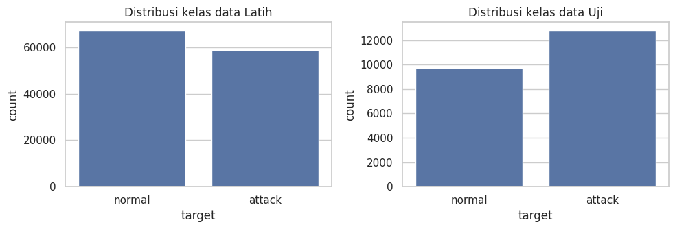
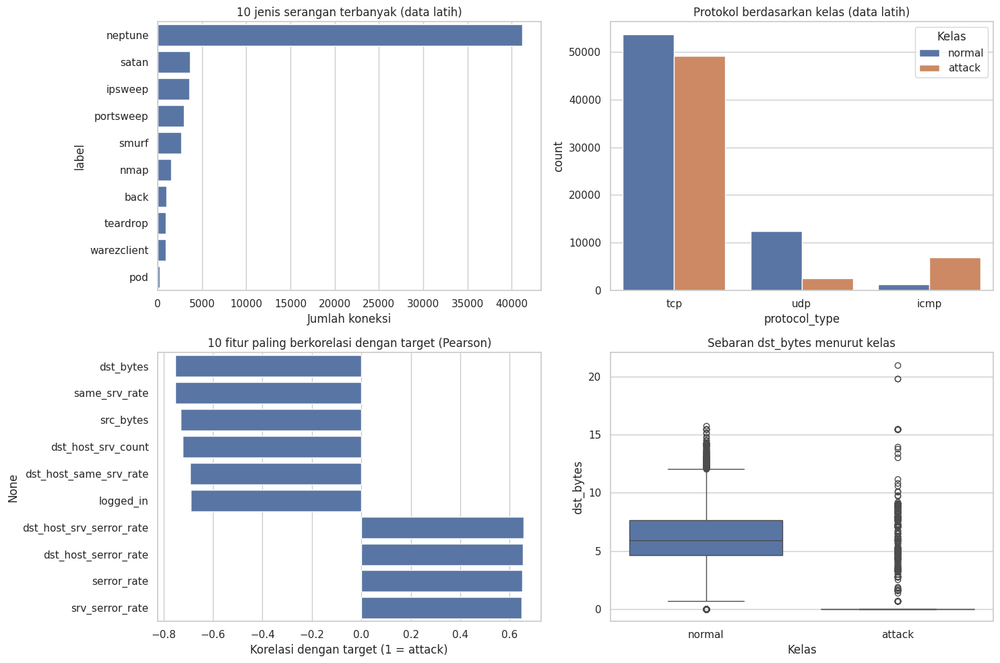
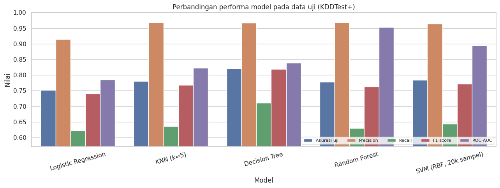
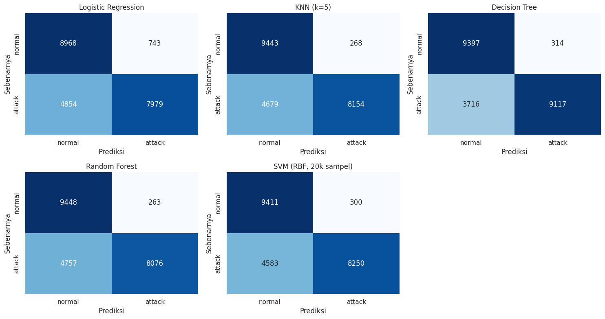
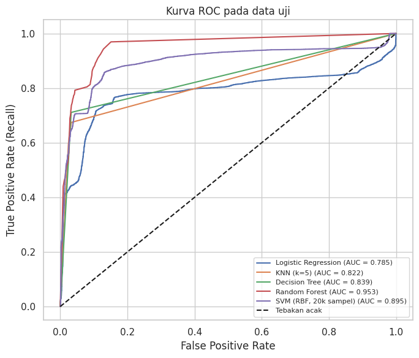
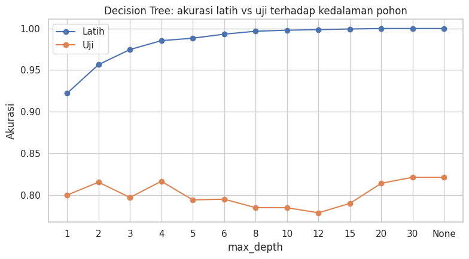
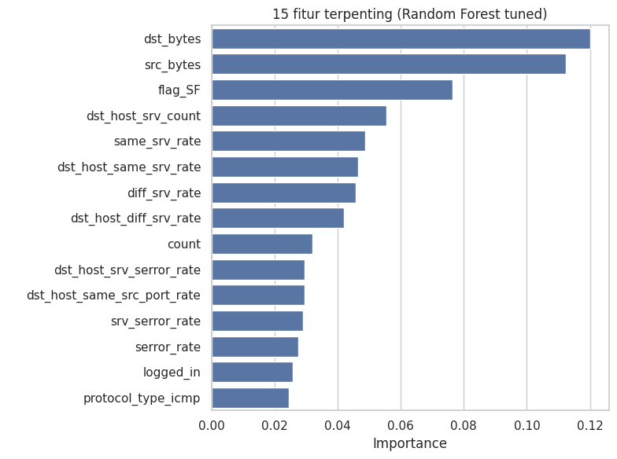
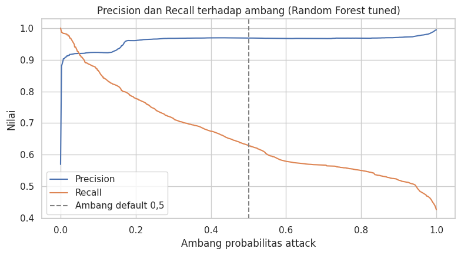
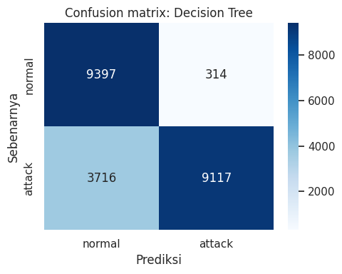
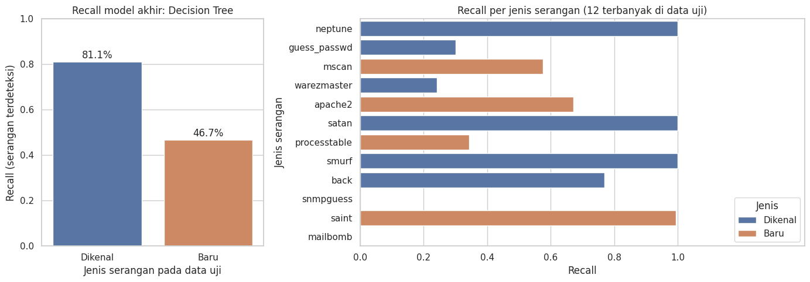

# Deteksi Intrusi Jaringan pada Dataset NSL-KDD


Klasifikasi biner **Normal vs Attack** pada dataset **NSL-KDD** dengan lima algoritma machine learning, lengkap dengan evaluasi (confusion matrix, ROC), *cross validation*, *hyperparameter tuning*, eksperimen PCA, dan analisis kesalahan. Proyek ini adalah lanjutan dari [EDA dan PCA pada NSL-KDD](https://github.com/rik0sec/nsl-kdd-eda-pca-analysis) dan dikerjakan sebagai tugas UTS Machine Learning.

## Daftar Isi
- [Ringkasan Hasil](#ringkasan-hasil)
- [Dataset](#dataset)
- [Metodologi](#metodologi)
- [Hasil dan Visualisasi](#hasil-dan-visualisasi)
- [Temuan Penting](#temuan-penting)
- [Keterbatasan](#keterbatasan)
- [Struktur Repository](#struktur-repository)
- [Cara Menjalankan](#cara-menjalankan)
- [Referensi](#referensi)

## Ringkasan Hasil

Model akhir: **Decision Tree**, dievaluasi pada `KDDTest+` (22.544 koneksi).

| Metrik (kelas attack) | Nilai |
|---|---|
| Akurasi | **0,8212** |
| Precision | 0,9667 |
| Recall | 0,7104 |
| F1-score | 0,8190 |
| ROC-AUC | 0,8392 |
| Confusion matrix | TN 9.397 · FP 314 · FN 3.716 · TP 9.117 |

Akurasi cross validation pada data latih mencapai 97% sampai 99,9%, tetapi hanya 75% sampai 82% pada data uji. Penyebabnya dianalisis di [Temuan Penting](#temuan-penting): data uji memuat **17 jenis serangan baru** yang tidak ada di data latih.

## Dataset
- **Sumber:** [NSL-KDD di Kaggle (hassan06)](https://www.kaggle.com/datasets/hassan06/nslkdd)
- **Data latih:** `KDDTrain+.txt`, 125.973 baris (normal 53,46%, attack 46,54%)
- **Data uji:** `KDDTest+.txt`, 22.544 baris (normal 43,08%, attack 56,92%)
- **Fitur:** 41 fitur (3 kategorikal: `protocol_type`, `service`, `flag`) + `label` + `difficulty`
- **Target biner:** `0` = normal, `1` = attack (seluruh jenis serangan digabung)

Dataset tidak disertakan di repo. Lihat [`data/README.md`](data/README.md).

## Metodologi

1. **Pra-pemrosesan:** pemeriksaan missing value dan duplikat (tidak ada), label biner, pembuangan `label`, `difficulty`, dan kolom konstan (`num_outbound_cmds`), transformasi `log1p` pada `duration`, `src_bytes`, `dst_bytes`, One-Hot Encoding, dan StandardScaler. Semua transformasi di-fit **hanya pada data latih** untuk mencegah *data leakage*. Hasil akhir: 121 fitur.
2. **Model (5 algoritma):** Logistic Regression, KNN (k=5), Decision Tree, Random Forest, dan SVM RBF (dilatih pada sampel 20.000 baris).
3. **Evaluasi:** akurasi, precision, recall, F1, ROC-AUC, confusion matrix, dan kurva ROC pada data uji.
4. **Cross validation:** Stratified 5-Fold pada data latih.
5. **Hyperparameter tuning:** `RandomizedSearchCV` (metrik F1, 3-fold) untuk Decision Tree, Random Forest, dan SVM.
6. **Eksperimen tambahan:** PCA (95% varians), feature importance, analisis ambang keputusan, dan analisis kesalahan serangan dikenal vs baru.

## Hasil dan Visualisasi

### Distribusi kelas


Kelas cukup seimbang pada data latih maupun uji, tetapi data uji memiliki proporsi attack lebih tinggi.

### EDA ringkas


`neptune` mendominasi serangan (sekitar 70% di data latih), ICMP paling rawan secara proporsi, dan fitur seperti `dst_bytes`, `same_srv_rate`, dan `src_bytes` paling berkorelasi negatif dengan serangan.

### Perbandingan model (data uji)

| Model | Akurasi | Precision | Recall | F1 | ROC-AUC |
|---|---:|---:|---:|---:|---:|
| **Decision Tree** | **0,8212** | 0,9667 | **0,7104** | **0,8190** | 0,8392 |
| Decision Tree (tuned) | 0,8015 | 0,9682 | 0,6734 | 0,7943 | 0,8313 |
| SVM RBF (20k sampel) | 0,7834 | 0,9649 | 0,6429 | 0,7716 | 0,8947 |
| KNN (k=5) | 0,7806 | 0,9682 | 0,6354 | 0,7673 | 0,8224 |
| Random Forest | 0,7773 | 0,9685 | 0,6293 | 0,7629 | 0,9526 |
| SVM (tuned) | 0,7768 | 0,9658 | 0,6303 | 0,7628 | 0,9167 |
| Random Forest (tuned) | 0,7764 | 0,9685 | 0,6277 | 0,7617 | **0,9631** |
| Logistic Regression | 0,7517 | 0,9148 | 0,6218 | 0,7403 | 0,7850 |



### Confusion matrix


Pada semua model, serangan yang lolos (FN) jauh lebih banyak daripada alarm palsu (FP).

### Kurva ROC


### Cross validation vs data uji

| Model | Akurasi CV (5-fold) | Akurasi uji |
|---|---:|---:|
| Logistic Regression | 0,9747 | 0,7517 |
| KNN (k=5) | 0,9974 | 0,7806 |
| Decision Tree | 0,9985 | 0,8212 |
| Random Forest | 0,9988 | 0,7773 |
| SVM RBF (20k sampel) | 0,9926 | 0,7834 |

### Kedalaman Decision Tree


### Feature importance


### Ambang keputusan (threshold)


Pada Random Forest (tuned), menurunkan ambang dari 0,5 ke 0,1 menaikkan recall dari 0,63 menjadi 0,87, dengan harga alarm palsu naik dari 263 menjadi 926.

### Model akhir


### Analisis kesalahan: serangan dikenal vs baru


## Temuan Penting

1. **Akurasi CV sangat tinggi, akurasi uji jauh lebih rendah.** Ini bukan overfitting biasa: kedalaman pohon, tuning, dan PCA tidak menutup selisihnya.
2. **Penyebabnya adalah perbedaan distribusi.** Data uji memuat 17 jenis serangan yang tidak ada di data latih (29,22% dari seluruh serangan uji). Recall model akhir **81,1%** untuk serangan dikenal, tetapi hanya **46,7%** untuk serangan baru.
3. **Tuning tidak membantu di data uji.** Parameter terbaik menurut CV tidak menaikkan akurasi atau F1 di data uji, walau ROC-AUC Random Forest dan SVM membaik.
4. **PCA tidak membantu.** Fitur turun dari 121 menjadi 21, tetapi akurasi turun pada semua model dan model berbasis pohon justru lebih lambat dilatih.
5. **Recall adalah titik lemah.** Sekitar 29% serangan di data uji lolos pada model akhir. Menurunkan ambang keputusan menaikkan recall dengan konsekuensi lebih banyak alarm palsu.

## Keterbatasan
- Model akhir dipilih berdasarkan F1 pada data uji, sehingga data uji ikut menentukan pilihan. Pemilihan yang lebih ketat memakai data validasi terpisah.
- SVM dilatih pada sampel 20.000 baris, dan tuning dilakukan pada sampel 30.000 baris dengan 12 iterasi pencarian.
- Model ini belum layak menjadi satu-satunya pertahanan karena sebagian besar serangan baru lolos.
- Angka berasal dari satu kali run di Google Colab. Hasil dapat sedikit berbeda pada versi library lain.

**Pengembangan lanjutan:** gradient boosting (XGBoost atau LightGBM), deteksi anomali untuk serangan baru, klasifikasi multikelas (DoS, Probe, R2L, U2R), dan validasi dengan pembagian data yang lebih ketat.

## Struktur Repository
```
nsl-kdd-intrusion-detection-binary/
├── README.md
├── LICENSE
├── requirements.txt
├── .gitignore
├── data/
│   └── README.md                              # cara mengunduh dataset
├── notebooks/
│   └── uts_klasifikasi_biner_nsl_kdd.ipynb    # notebook utama (output tersimpan)
└── images/                                    # grafik hasil analisis
```

## Cara Menjalankan

**Lokal**
```bash
git clone https://github.com/rik0sec/nsl-kdd-intrusion-detection-binary.git
cd nsl-kdd-intrusion-detection-binary

python -m venv .venv
source .venv/bin/activate        # Windows: .venv\Scripts\activate
pip install -r requirements.txt

# unduh KDDTrain+.txt dan KDDTest+.txt ke folder data/ (lihat data/README.md)
jupyter notebook notebooks/uts_klasifikasi_biner_nsl_kdd.ipynb
```

**Google Colab**
1. Unggah notebook ke Colab.
2. Unggah `KDDTrain+.txt` dan `KDDTest+.txt` ke `/content/` lewat panel *Files*.
3. Jalankan semua sel. Tuning Random Forest dan SVM memakan waktu beberapa menit (sekitar 3 dan 7 menit di Colab).

## Referensi
- M. Tavallaee, E. Bagheri, W. Lu, A. A. Ghorbani, "A Detailed Analysis of the KDD CUP 99 Data Set," *IEEE Symposium on Computational Intelligence for Security and Defense Applications (CISDA)*, 2009.
- Dataset NSL-KDD: <https://www.kaggle.com/datasets/hassan06/nslkdd>

## Penulis
**Riko Nugroho** · GitHub: [@rik0sec](https://github.com/rik0sec)
